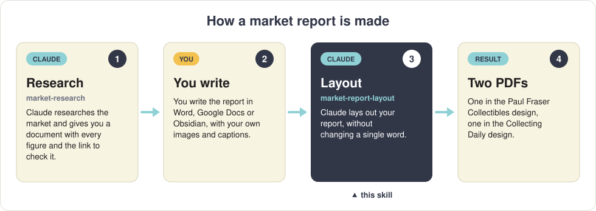
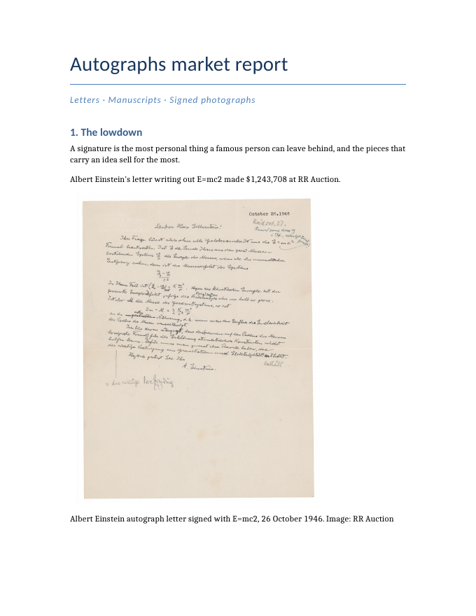
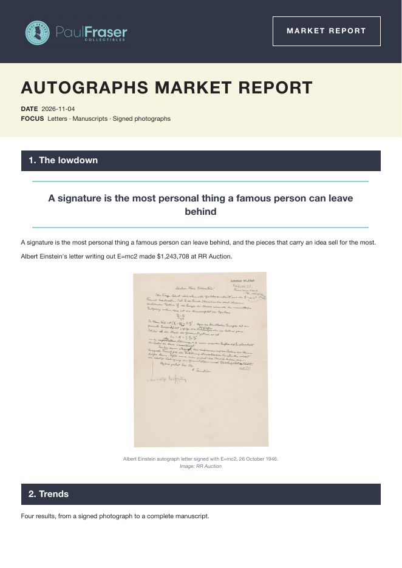
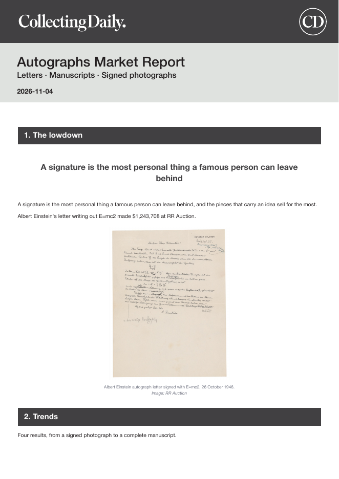
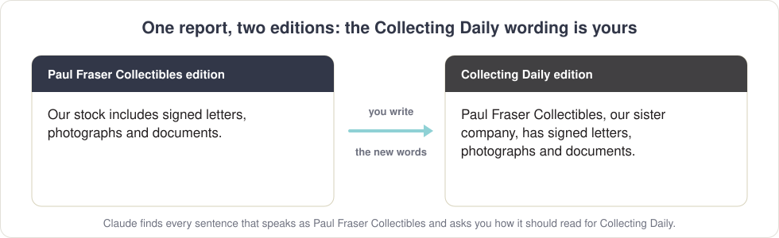
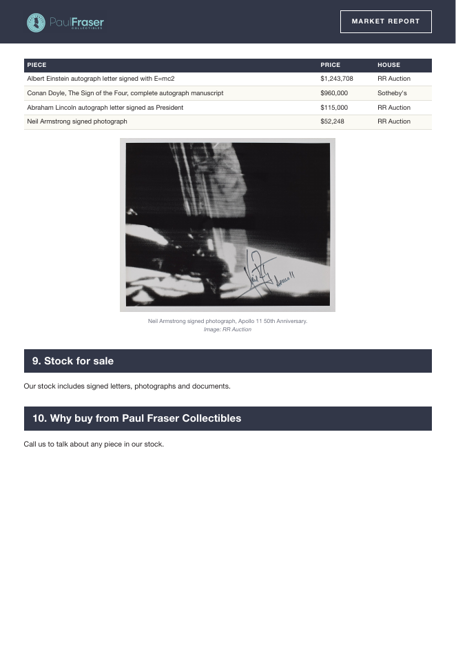
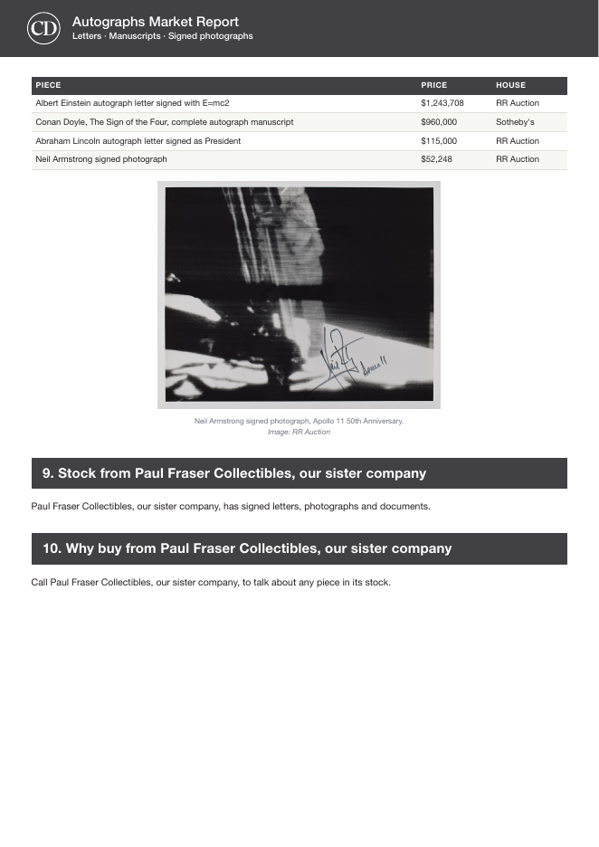

# Market report layout

**You write the market report. Claude turns it into two finished, designed PDFs: one for Paul Fraser Collectibles and one for Collecting Daily.**

<p align="center"></p>

This skill is step 3. It only does the design. **It never changes a word you wrote**: before it makes a PDF it checks every word and every figure against your file, and if anything is different it refuses. For step 1, the research, see [market-research](https://github.com/CollectingDaily/claude-market-research).

---

## What goes in, what comes out

<table>
<tr>
<td width="33%" align="center"><strong>What you write</strong><br><sub>a normal Word document</sub></td>
<td width="33%" align="center"><strong>Paul Fraser Collectibles edition</strong><br><sub>PF — Autographs market report.pdf</sub></td>
<td width="33%" align="center"><strong>Collecting Daily edition</strong><br><sub>CD — Autographs market report.pdf</sub></td>
</tr>
<tr>
<td></td>
<td></td>
<td></td>
</tr>
</table>

Same words, same photographs, same pages, in two designs. You also get a web page (HTML) of each edition.

---

## Writing your report

Write it wherever you like: **Word, LibreOffice, Google Docs or Obsidian**. There are only three things to know.

**1. Use headings for your sections.** In Word or Google Docs, pick *Heading 1* from the styles menu. Each heading becomes a section band in the PDF. Want a head start? [`template/Market report template.docx`](template/Market%20report%20template.docx) has the eleven sections of a market report ready to fill.

**2. Put each photograph where it belongs, and write its caption on the line directly under it**, with the credit at the end:

> *Albert Einstein autograph letter signed with E=mc2, 26 October 1946. Image: RR Auction*

That line becomes the caption under the photograph. A photograph with no line under it gets no caption. Claude never writes one for you.

**3. Save it as a Word file (.docx).** From Google Docs: **File → Download → Microsoft Word (.docx)**. From Obsidian, just use your `.md` file and its images. Please don't send a PDF: Claude needs the words, not a picture of them.

---

## Making the PDFs

1. **Put your report in a folder** (photographs can be inside the document, or beside it in the same folder).
2. **Open that folder in the Claude app** (Code tab → Local → Select folder).
3. **Ask:** */market-report-layout Lay out the report in this folder.*
4. **Answer the Collecting Daily questions**, if there are any (see below).
5. **Collect your files** from the new **PDFs** folder, inside your report folder:

```
Your report folder/
    Autographs market report.docx               ← what you wrote
    PDFs/
        PF — Autographs market report.pdf       ← Paul Fraser Collectibles edition
        CD — Autographs market report.pdf       ← Collecting Daily edition
    HTML/                                       ← the web versions
```

Claude also tells you about anything worth a second look before it goes out: a "TEXT TO GO HERE" you forgot, or a sentence that mentions a picture you didn't include. It never fixes these itself. Change your document and ask again.

---

## The Collecting Daily edition

In a Collecting Daily document, "we" means Collecting Daily, so Paul Fraser Collectibles becomes *"our sister company"*. If your report talks as Paul Fraser Collectibles ("our stock", "we have sold"), the Collecting Daily edition needs different words in those places, and **you write them**.

<p align="center"></p>

Claude finds those sentences, shows them to you, and asks how each should read. It uses your words exactly. Everything else is the same in both editions, and Claude checks that, page by page.

<p align="center">
  
  &nbsp;
  
</p>
<p align="center"><em>Page 2 of each edition. Sections 9 and 10 carry the writer's Collecting Daily wording.</em></p>

---

## Steering the design

Claude decides where things sit, which sentences to repeat large as pull quotes, and which figures go in boxes. To steer it, just say so when you ask:

- *put the price table in a box*
- *use "A signature is the most personal thing a famous person can leave behind" as a pull quote*
- *no pull quotes, please*

A pull quote must be your own words, exactly: Claude can't invent one.

---

## What you need

| | |
| --- | --- |
| 🤖 **The Claude app**, with its **Code** tab | A paid Claude plan (Pro, Max, Team or Enterprise). Download it from [claude.com](https://code.claude.com/docs/en/desktop-quickstart). |
| 🐍 **Python 3** | Macs have it. On Windows: open the **Microsoft Store**, search for **Python Install Manager** and click **Install**. |
| 🌐 **Google Chrome or Microsoft Edge** | Used to draw the pages. Every Windows PC has Edge. |

Built and tested on a Mac, and written to run on Windows too.

## Installing it

1. **Open the Claude app**, click the **Code** tab, choose **Local** and any folder (such as Documents).
2. **Paste this** into the message box and press **Return**:

   ```text
   Install the skill from https://github.com/CollectingDaily/claude-market-report-layout into ~/.claude/skills/claude-market-report-layout
   ```

3. **Click Allow** when Claude asks to download it.
4. **Quit the Claude app completely** (⌘ Q) and open it again. Type **/** in the message box and look for **market-report-layout** in the list. If it's there, you're ready.

New to Claude, or setting up a Mac for the first time? The [Collecting Daily page](https://github.com/CollectingDaily) explains everything step by step, including how to update your skills.

---

## Questions

**Will Claude change my words?**
No. It checks every word and figure in the PDF against your file and refuses to make the PDF if anything differs. Typos included: fix them in your document.

**Can it find photographs for me?**
No, by design. You choose the photographs and write their captions.

**My report is in Google Docs.**
Download it as Word: **File → Download → Microsoft Word (.docx)**.

**Can I change the report after the PDFs are made?**
Yes. Edit your document, save it, and ask Claude to lay it out again.

---

<details>
<summary><strong>For the technically minded</strong></summary>

`SKILL.md` is the full procedure. `scripts/ingest.py` copies the draft untouched and extracts its images; `scripts/build.py` flows the blocks into A4 pages in headless Chrome, checks nothing is clipped, runs `scripts/textcheck.py` (every word and figure the writer's, in order), prints the PF edition, makes the CD edition with `scripts/cd_edition.py` (banners, colours, contact box, and the writer's wording from `<Title>.cd.md`) and compares the two PDFs page by page. `scripts/odt.py` reads LibreOffice files, `scripts/dmd.py` is the layout markdown, `scripts/system.py` handles Mac and Windows differences. With poppler installed (`pdftoppm`, `pdftotext`), page previews come from the PDFs and the editions are compared; without it the editions are not compared. The `template/` folder also has a LibreOffice template in the PFC design for laying out a report by hand.

</details>
